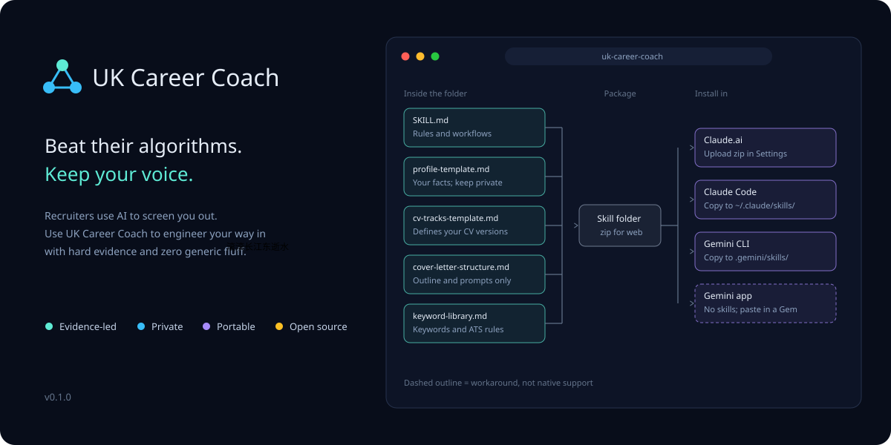

<p align="center">
  
</p>

# UK Career Coach

Use AI to beat the AI world! 

An open skill for UK job applications. It evaluates a job description against your profile, maps keyword gaps, recommends which CV version to use, and proofreads. 

Feel free to connect with me on LinkedIn: https://www.linkedin.com/in/gexinrui/

**Language** English (British) · **Works with** Claude, Gemini CLI

## What it does

| Give it | It returns |
|---|---|
| A job description (pasted or linked) | A five-part fit assessment, an ATS keyword gap list, and a salary check against current sources |
| A CV | Before and after suggestions, a recommended CV version, and consistency checks |
| A cover letter request | Three questions first, then a five-paragraph outline with prompts. Prose only if you ask |
| A CV or letter to proofread | Spelling, tense, passive voice, vague numbers and formatting issues, as before and after pairs |
| Counts by application stage | A plain reading of what the funnel shows, and what it cannot show |

## Principles

1. **AI audits; you author.** Facts, claims and final wording stay with you.
2. **Built not to invent.** It is instructed never to make up achievements, tools, titles, numbers or dates, and to report gaps instead. This is an instruction, not a guarantee, so check every line.
3. **Blockers first.** Citizenship, clearance, seniority and pay mismatches are flagged before anything else.
4. **You control your files.** Your profile is plain Markdown that you keep and edit. What you paste or upload is sent to the AI provider you run the skill with, so see [Privacy](#privacy-and-responsibility).

## Quick start

1. **Install** the skill (below).
2. **Personalise it first** (below). This step makes it useful, and it needs your CV.
3. **Use it.** Paste a job description and ask, for example: *"Assess this role against my profile and tell me which CV version to use."*

## Install

Download `uk-career-coach.zip`. The zip contains only the skills folder, which Claude.ai expects.

| Where | How |
|---|---|
| Claude.ai | Turn on code execution, then upload the zip in Settings under Skills (menu names change; see Anthropic's help centre) |
| Claude Code | Unzip into `~/.claude/skills/` (personal) or `.claude/skills/` (per project) |
| Gemini CLI | Unzip into `~/.gemini/skills/` or `.gemini/skills/` |
| Gemini app | No native skill support. Create a Gem and paste the contents of `SKILL.md` into its instructions |

Custom skills do not sync between products, so install them separately where you use them. Checked on 25 October 2026; these routes change, so confirm against the official documentation.

## Personalise it first

The skill ships with blank templates, so out of the box it is generic. After installing, make this your first step:

1. Open your tool's skill editor with this skill loaded. If your app has a skill-creator skill, use that. If it has no editor, edit the Markdown files yourself.
2. Upload your current CV and any tailored versions you already have.
3. Paste this prompt:

```text
Personalise the uk-career-coach skill for me using my CV.

1. Fill references/profile-template.md from my CV and save it as references/profile.md, leaving the template untouched. Ask me about anything missing, such as right to work, salary floor, target roles and locations. Do not invent or infer facts.
2. Propose two to four CV tracks using references/cv-tracks-template.md and save them as references/cv-tracks.md: name, target roles, lead evidence, vocabulary, and what each track does not claim.
3. Show me every change as before and after, and wait for my approval before saving anything.
```

4. Review the result line by line. The coach treats everything in your profile as fact, so correct anything wrong. If your app installs skills from a zip, re-zip and re-upload the personalised folder.

This step sends your CV to the AI provider you are using. Check its data settings, consider removing your phone number and home address first, and keep `profile.md` and `cv-tracks.md` out of any public repository. The `.gitignore` in this repo already excludes those names.

## Repository layout

```
.
├── README.md
├── assets/                     banner and social preview image
├── docs/funnel.png             the author's application funnel (n = 1)
└── skills/uk-career-coach/
    ├── SKILL.md                rules and workflows the coach follows
    └── references/
        ├── profile-template.md         blank profile fields
        ├── cv-tracks-template.md       how to define your CV versions
        ├── cover-letter-structure.md   outline and prompts only
        └── keyword-library.md          starter keywords and ATS rules
```

Your own `profile.md` and `cv-tracks.md` are created in `references/` when you personalise the skill. They are personal, so they are not part of this repository.

## Limitations

- **Sample of one.** Nothing here has been tested on other people.
- **Only as good as your inputs.** The coach works from the CV, profile and job descriptions you give it, and cannot check them.
- **Market data goes stale.** The skill asks for current sources and dates; verify anything it cites.
- **Keyword banks are seeds.** Confirm them against real job descriptions before relying on them.
- **ATS behaviour varies by employer.** Optimising wording is not the same as presenting your experience accurately; the skill treats accuracy as the constraint.

## Privacy and responsibility

Do not commit your profile, CV or employer-confidential material to a public repository. Anything you paste or upload is processed by the AI provider you use, so read their data and retention settings first. This skill is not career, legal or immigration advice; check right-to-work and visa rules with official sources. It is an independent project and is not affiliated with or endorsed by Anthropic or Google.

## Feedback

If you use it, open an issue describing what worked and what did not, including failures. Real use is more informative than stars.

## Licence

See [LICENSE](LICENSE).
